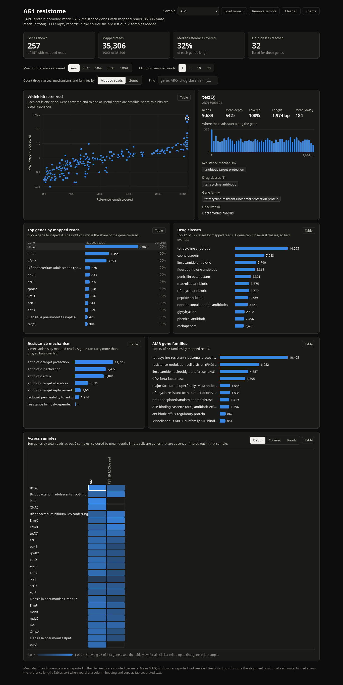

# RGI-BWT Explorer

Interactive browser GUI for **`rgi bwt`** (RGI read-mapping / CARD) results. Drop in one or more `*.allele_mapping_data.json` files and explore genes, coverage, depth, MAPQ, drug classes and cross-sample patterns — **no server, no upload, no dependencies**. Everything runs in your browser tab and works fully offline.

**Live:** https://weparadox.github.io/RGI-BWT-Explorer/

## Why this is useful

`rgi bwt` writes a rich per-allele JSON (depth, %coverage, length coverage, MAPQ, per-read alignments, resistome annotations) but no interactive viewer — you end up in spreadsheets or one-off scripts. This tool turns those files into an explorable view:

- **Zero setup:** single static HTML file. Open it, drop JSONs in. Also works offline — download `index.html` once and keep it next to your RGI runs.
- **Multi-sample:** load any number of samples at once (e.g. every `*/*.allele_mapping_data.json` under an rgi run directory). Sample dropdown switches views instantly; remove samples individually.
- **Cross-sample heatmap:** top genes × samples, cells coloured by mean depth / coverage / reads (log scale). Click a cell to jump to that gene in that sample. Table view for the full matrix.
- **Search:** gene name, ARO accession (`aro:` prefix too), drug class, family, mechanism, pathogen — multi-term AND. Every view (scatter, bars, KPIs, heatmap) respects the search and the coverage/read thresholds together.
- **"Which hits are real" scatter:** %coverage × mean depth per gene (size/tone cues, log depth axis) — credible full-coverage hits separate from short thin spurious ones at a glance.
- **Gene detail:** reads, depth, coverage, length, MAPQ + 50-bin read-start histogram along the reference + mechanism / drug-class / family / observed-pathogen chips.
- **Sortable, copyable tables:** every chart has a Table toggle; click column headers to sort (numeric-aware); *Copy as TSV* for notebooks/ELN.
- **Thresholds you already use:** min mapped reads (1/5/10/20) and min reference coverage (Any/20/50/80/100%) filters, applied live across all views.
- **Dark/light theme** (follows system, manual toggle, remembered).

## Input

Any `rgi bwt` result file: `<sample>.allele_mapping_data.json` (produced by `rgi bwt` against CARD). Sample names are derived from filenames; empty `{}` placeholder records are skipped automatically. Files are read locally in the browser — nothing is sent anywhere.

## Usage

1. Open the [live site](https://weparadox.github.io/RGI-BWT-Explorer/) (or the downloaded `index.html`).
2. **Browse files…** or drag-and-drop one or more `*.allele_mapping_data.json` files.
3. Pick a sample from the dropdown; filter, search, click genes, switch cards to Table, copy TSV.
4. With 2+ samples loaded, scroll to **Across samples** for the comparison heatmap.

## Notes

- Reads are counted per mate (as reported by RGI); mean depth, %coverage and MAPQ are as reported, not rescaled.
- The 50-bin read-start histogram is computed from per-read alignment positions binned across the reference length.
- Fully client-side vanilla JS — no analytics, no CDN, no network calls.

## License

[MIT](LICENSE) © 2026 WeParadox
